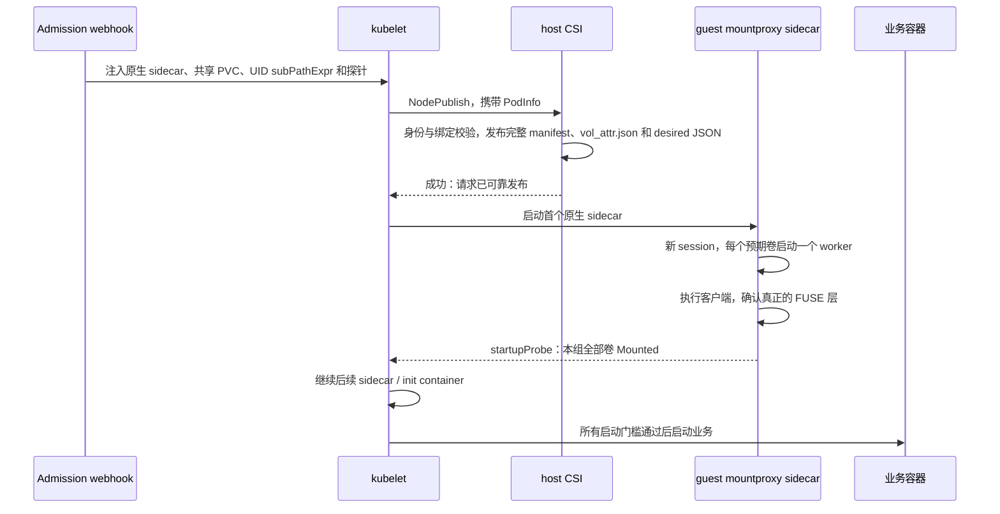

# RunD 3 FUSE 方案设计、生命周期与 Review 指南

后续目标方案以 [FUSE Sidecar 挂载模式设计](fuse-sidecar-design-zh.md) 为准；该新设计尚未实现。本文保留实验实现及已完成验证的说明。

本文对应 [PR #12](https://github.com/AlbeeSo/alibaba-cloud-csi-driver/pull/12)，E2E 基线为 `8ab92f00e`，环境验证于 2026-11-16 完成，文档整理于 2026-11-17。后续驱动自动启用、固定启动配置和 CSI 自动卷清单仅进行本地代码测试，尚未在新环境 E2E。

当前方案是在宿主机 CSI 中发布 Pod 隔离的挂载请求，由业务 Pod 的原生 sidecar 在 RunD guest 内执行 FUSE 挂载。ossfs、ossfs2、customfuse 复用同一文件协议、状态模型和生命周期。webhook 只负责自动构造 sidecar，可以关闭或逐 Pod 绕过。

最需要 Review 的契约是：**NodePublish 成功代表请求已可靠落盘，实际挂载成功由 sidecar 的 startupProbe 保证；这不是一次同步的 CSI 挂载成功响应。** 运行期故障会影响 readiness，但不会自动停止业务或透明恢复已有挂载。

## 1. 实际调研的 RunD 环境

| 项目 | 实测环境或结果 |
| --- | --- |
| Kubernetes | ACK `v1.33.3-aliyun.1` |
| 节点池运行时 | `Sandboxed-Container.runv`，版本 `2.2.4` |
| 容器引擎 | `containerd://1.6.28` |
| 节点 | 弹性裸金属 `ecs.ebmc6.26xlarge`，Alibaba Cloud Linux 3，Flannel |
| 磁盘 | 40 GiB 系统盘、200 GiB 数据盘；该沙箱节点池要求数据盘至少 200 GiB |
| 自动创建的 RuntimeClass | `runv`，handler 为 `runv`；没有自动创建名为 `rund` 的 class |
| RuntimeClass 调度契约 | `alibabacloud.com/container-runtime: Sandboxed-Container.runv`，固定内存 overhead 为 64Mi |
| 节点标记 | 上述运行时 label，以及 `alibabacloud.com/container-runtime-version=2.2.4` |
| 实际 handler 实现 | containerd 的 `runv` handler 映射到 `runtime_type = "io.containerd.rund.v2"` |
| 实际 shim | `/usr/local/bin/containerd-shim-rund-v2` |
| host / guest | host kernel 为 `5.10.134-19.8.al8.x86_64`，guest 为 `4.19.91-685c634.al7.x86_64`；boot ID 不同 |
| guest 文件系统 | 观察到 `kataShared`、`virtio_fs` 导出 |
| Pod 注解 | 沙箱控制器自动写入 `securecontainer.alibabacloud.com/cpus` 和 `securecontainer.alibabacloud.com/memory` |

因此，`runv` 是这里的 Kubernetes 接口名称，底层确实运行 RunD；不能单靠字面名称 `runtimeClassName: rund` 判断运行时。上述注解也不是本方案选择协议的开关。

另有两个直接影响设计的实测发现：

1. **guest 内 privileged 不等于继承 host 的设备。** containerd 配置为 `privileged_without_host_devices=true`，最初没有 `/dev/fuse`。在 guest 创建字符设备 `10:229` 后可以读写打开。实现中由 file-mode mountproxy 在缺失时创建设备，并校验类型、主次设备号和可打开性；不会替换已有普通文件或符号链接。
2. **额外 HostPath 别名不等于同一个共享卷。** 最初把 Pod 的 kubelet CSI 子树通过另一条 HostPath 给 sidecar，sidecar 挂载和探针都成功，业务却读不到内容。RunD 将其导出为另一条 virtiofs 路径。改为把业务的同一个 PVC volume 直接挂给 sidecar 后，业务读取和 OSS API 写回均通过。

这里验证了 ACK 的这个 RunD 发行配置，不等于认证所有 RunD 版本，也没有验证原 Serverless 物理节点插件与 guest csi-agent 的整套环境。测试集群、裸金属实例、磁盘、EIP、SLB、测试镜像、OSS 桶和临时身份均已清理；没有把资源标识或凭据放进仓库。

## 2. 设计与职责边界

### 2.1 选择协议，区分发布者与执行者

继续使用已有的 `RundCSIProtocol3`，没有增加 FeatureGate 或 PV transport 参数。

| 执行入口 | gate 开启后的行为 |
| --- | --- |
| ControllerPublish | 查询目标 Node；匹配 ACK 沙箱运行时 label 时不再创建独立 FUSE Pod |
| host NodePublish | 查询真实 Pod，验证 UID、调度节点、RuntimeClass handler 与 selector、实际 Node label，然后发布文件 |
| RuntimeClass 别名 | handler 和 selector 相同即可，不要求 class 字面名为 `runv` |
| 原有字面 `rund` class | 未声明新 ACK 契约时保留 delegation，不因 Node label 相同就执行新文件发布 |
| `NewCSIAgent` 创建的实例 | 通过显式内部角色标识保留原 socket 执行路径，不进入 host 文件发布 |
| gate 关闭 | 使用既有逻辑 |

`clientset != nil` 不能区分 host 插件与 agent 角色；host 有 Kubernetes 客户端在新旧场景都成立。当前选择依据是实测运行时契约加显式 agent 入口，不是推测 clientset 的含义。

ControllerPublish 没有 PodInfo，只能按 Node 决策。因此，本次 gate 开启的沙箱节点面向沙箱 FUSE 消费者，不支持同节点混用普通 runc FUSE 消费者；后者在 NodePublish 会被拒绝。旧 Serverless 只做了角色和 delegation 回归测试，仍需该环境的 E2E。

### 2.2 注入和 Pod UID 隔离

webhook 在 CREATE 时解析已绑定的 PVC/PV，按 CSI driver 分组：一个 OSS sidecar 管理 ossfs/ossfs2，一个 customfuse sidecar 管理该 driver 的多个卷。每组只允许一个镜像 profile；custom 镜像可以通过 `/entrypoint.sh` 分派自己的客户端。

镜像 profile 由管理员配置，PV 可选择已配置 profile。关闭 webhook，或设置 Pod annotation `fuse.csi.alibabacloud.com/inject: "false"`，即可自行提供 sidecar、探针和挂载；CSI 文件发布不依赖 webhook 在线。

Admission 时不需要拿到 Pod UID：sidecar 用 Downward API 注入 `POD_UID`，kubelet 在启动时展开 `subPathExpr: $(POD_UID)`。目录如下：

```text
host:
  /var/run/ossfs/file-volumes/<podUID>/
  /var/run/customfuse/file-volumes/<podUID>/
    desired/<sha256(volumeHandle)>.json
    status/<sha256(volumeHandle)>.json
    session.json

sidecar:
  /volume-state/                       # 仅该 Pod、该 driver 的状态目录
  /pod-volumes/<PV-name>/mount          # 与业务共享同一个 PVC volume
```

sidecar 的 PVC mount 使用 Bidirectional，业务 mount 使用 HostToContainer，保留业务只读标志。CSI 根据真实 Pod 的 PVC/PV 自动生成每个 driver 的完整 `manifest.json`，runner 和探针使用该清单，不需要用户填写预期卷参数；多出来的请求文件不会被执行。隔离限制了正常进程可见的配置范围，但 privileged sidecar 本身是可信组件，不构成抵御恶意特权租户的安全边界。

### 2.3 JSON 和 mountproxy 语义

`Desired` 嵌入 block/NFS 使用的 `directvolume.MountInfo`，新增版本、Pod UID、generation、requiredFeatures，以及实际的 `proxy.MountRequest`，没有再维护一份平行请求 DTO。

CSI 同时写 kubelet 目标目录旁的 `vol_attr.json` 和上述 `desired` 文件。文件通过临时文件、原子替换和 fsync 发布，文件权限 0600、目录 0700。双路径不是一个跨文件事务；只有完成发布流程才返回成功，重试用于补齐。请求内可包含 Secret，不能直接打印或作为公开排障附件。

`result` 保留原挂载 `proxy.Response`，`unmountResult` 记录卸载响应，`phase/error` 表示后续生命周期；generation 对应请求内容，session 对应当前 runner。未知可选请求字段可以保留、回写并参与 digest；新行为仍需要新 consumer 实现，不能安全忽略的能力需使用 requiredFeatures 或版本升级。

文件模式自动启用所有已编入、实现文件挂载接口的驱动（当前为 ossfs、ossfs2、customfuse），按每卷 `MountProxy.Fstype` 分派，不需要 `--driver`。该 flag 只保留 socket 模式的选择语义。自动启用不会启动客户端进程，也不会替镜像安装缺失的客户端；NAS 等未实现文件接口的驱动不会初始化。

## 3. 生命周期

### 3.1 正常启动



注入使用 `initContainers[].restartPolicy: Always`，不是普通的、运行后退出的 init container。各 sidecar 按 init 顺序启动；一组内部的多个卷并行挂载，单个卷阻塞不会掩盖同组其他卷的结果。前一个 sidecar 的 startupProbe 未通过，后一个 sidecar 尚不会启动。

探针要求每个预期卷都有合法请求、匹配的 UID/generation/session、`Mounted` 状态，以及不超过 10 秒的 heartbeat。worker 约每秒更新状态。挂载检查排除底层 virtiofs 投影；OSS 凭据 interceptor 也不能因为投影本身是 mountpoint 就跳过真正挂载。

原生 sidecar 的启动门槛、Job 完成及反向停止顺序采用标准 Kubernetes 能力，见 [Kubernetes 1.33 sidecar 生命周期](https://v1-33.docs.kubernetes.io/docs/concepts/workloads/pods/sidecar-containers/)。

### 3.2 首次挂载失败和重试

| 故障位置 | CSI / 状态 | 用户可见表现及后续行为 |
| --- | --- | --- |
| Pod 身份、运行时、能力校验或文件发布失败 | NodePublish 返回错误 | kubelet 的卷准备失败，业务不启动；这是 CSI 层错误 |
| 请求已发布，客户端挂载失败或超时 | NodePublish 已成功；worker 写 `Failed`、`result.error` 和原因 | startupProbe 不通过，业务停留在初始化阶段；不会把这个异步失败补发成 CSI RPC 错误 |
| desired 请求一直未到齐 | 对应 worker 等待，探针失败 | 缺卷不会被忽略；即使其他卷成功也不启动业务 |
| `/dev/fuse` 准备失败等 runner 初始化故障 | 可能尚无卷状态，sidecar 直接退出 | 看 sidecar 日志和退出原因，kubelet 重启；不能假设所有早期故障都有 `result.error` |

默认单次挂载 timeout 为 30 秒。一次挂载失败后，该 worker 记录失败并继续维护状态，不在同一 session 中无限重挂。注入的 startupProbe 每 2 秒检查一次、连续 60 次失败后触发 sidecar 重启，约两分钟加调度和终止开销。新进程创建新 session 并重新尝试；持续失败可能进入重启退避。

这不是给整个 Pod 设置固定两分钟挂载上限。手动 sidecar 的探针、超时和重启效果取决于其配置。上述重启机制来自配置和代码；E2E 验证了失败阻止业务及显式清理，没有穷尽整个 CrashLoopBackOff 重试过程。

### 3.3 已成功挂载后的故障

worker 监测进程 exit channel 和挂载表。进程退出或 FUSE 挂载消失后，状态变成 `Failed`，`error` 记录生命周期原因；最初成功的 `result` 保留，不改写成初始挂载失败。

此时 startupProbe 已结束，readinessProbe 才是持续门槛。默认每 2 秒检查，连续 3 次失败使 Pod NotReady；进程故障识别、探针采样和 kubelet 更新还会带来延迟。**readiness 失败不会杀死 sidecar，也不会停止或重启业务容器。** 当前没有 livenessProbe 或运行期自动重挂策略。业务 I/O 可能报错或阻塞，NotReady 只影响遵循 Pod readiness 的流量路径，不能代替业务 I/O 故障处理。

如果 mountproxy 自身崩溃或被 OOM/SIGKILL，kubelet 可以独立重启原生 sidecar，但新 session 不会自动重启已经运行的业务。即使重挂成功，业务已有 bind mount / FD 也可能仍引用旧连接，因此当前运维策略是重建 Pod，不承诺透明恢复。对应集成测试验证新 session 与旧状态隔离，不等于验证运行中业务无损恢复。

### 3.4 Job 完成和优雅删除

正常终止顺序如下：

1. 业务容器先结束；原生 sidecar 不阻止 Job 进入完成流程。
2. kubelet 在业务停止后，按原生 sidecar 的逆序发送终止信号。
3. mountproxy 收到 SIGTERM/SIGINT，取消 runner，各 worker 对自己的目标显式卸载。
4. 成功写 `phase: Unmounted` 与成功的 `unmountResult`；失败写 `Failed` 与卸载原因，并向 runner 返回错误。
5. runner 等待 worker 收尾后返回，再调用 driver Terminate，结束、回收客户端进程。
6. kubelet 后续调用 NodeUnpublish，CSI 幂等删除 desired 和 `vol_attr.json`。NodeUnpublish 不会同步等待 guest 的卸载响应。

单卷 desired 被删除时，对应 worker 也会退出并执行卸载，因此不要求 NodeUnpublish 与 SIGTERM 有固定先后关系。没有读到过请求的 worker 会继续等待，直到 runner 被取消。状态文件和 session 保留供排障，当前没有自动保留期限 GC。

卸载先尝试普通 `umount`，遇 EBUSY 使用 `MNT_DETACH`；只移除 FUSE 层，不卸载底层 PVC 投影、不删除其目录。`Unmounted` 表示卸载调用成功或已无 FUSE 层；lazy detach 不等于所有引用立即释放，也不等于对象存储数据已完成持久化。业务应自行 close/fsync 并确认所需写回语义。

以上保证以 kubelet 给予足够的终止宽限期为前提。强杀、节点断电、guest 崩溃或宽限期耗尽时，Go defer 和状态落盘都不保证执行；本实现没有外部控制器进入死 guest 兜底卸载。不能把 `auto_unmount`、Pod 删除成功或 host 挂载表为空单独当成全部清理证明。

### 3.5 状态含义速查

| 状态 | 含义 |
| --- | --- |
| Pending | worker 已启动，还未执行有效请求 |
| Mounting | 请求已验证，正在执行挂载 |
| Mounted | 挂载调用成功，当前仍监测到进程和 FUSE 挂载 |
| Failed | 初始请求/挂载失败、配置变化、运行期挂载丢失，或卸载失败；结合 result/error/unmountResult 判断 |
| Unmounted | worker 清理完成；可能来自初始失败后的清理，不能仅凭此判断该卷曾成功挂载 |

Pod 存活期间更改请求 generation 会使 worker 失败，不做热更新。CSI 重复发布相同内容幂等，不同内容返回配置变化错误；修改凭据或挂载配置应重建 Pod。

## 4. 代码 Diff 的 Review 顺序

先看行为契约，再看接线，最后看注入和部署。下面路径均相对仓库根目录；可用 `git diff origin/codex/rund3-fuse-base -- <路径>` 查看整份 PR，而不是只看最后一次修复提交。

| 顺序 | 主要文件 | Review 重点 |
| --- | --- | --- |
| 1. 协议与可靠发布 | [protocol.go](../pkg/mounter/proxy/filevolume/protocol.go)、[publication.go](../pkg/mounter/proxy/filevolume/publication.go)、[proxy/protocol.go](../pkg/mounter/proxy/protocol.go)、[direct_volume.go](../pkg/utils/rund/directvolume/direct_volume.go) | 是否复用 MountInfo 与实际 MountRequest；扩展字段、requiredFeatures、digest、路径和 UID 校验；双路径失败重试、权限与 Secret 暴露 |
| 2. 状态机与生命周期 | [runner.go](../pkg/mounter/proxy/filevolume/runner.go)、[file_backend.go](../pkg/mounter/proxy/server/file_backend.go)、[file_unmount_linux.go](../pkg/mounter/proxy/server/file_unmount_linux.go)、[main.go](../cmd/mount-proxy-server/main.go) | 初始响应与后续错误分离；并行 worker、session、heartbeat；显式卸载先于 Terminate；运行期不自动恢复的边界 |
| 3. 运行时与角色 | [rund.go](../pkg/mounter/proxy/filevolume/rund.go)、`pkg/{oss,customfuse}/{controllerserver,nodeserver,csi_agent}.go` | ACK 正向证据、Pod UID 和节点绑定；host delegation / agent 执行是否被误改；ControllerPublish 无 PodInfo 的限制 |
| 4. 通用客户端接线 | `pkg/{oss,customfuse}/file_publish.go`、`pkg/mounter/proxy/server/{ossfs,ossfs2,customfuse}/`、[mounter.go](../pkg/mounter/mounter.go)、[ossfs_secret.go](../pkg/mounter/interceptors/ossfs_secret.go)、[fuse_device.go](../pkg/mounter/proxy/server/fuse_device.go) | 复用原选项、凭据 interceptor、进程监管；MountReady 能否区分新 FUSE 与既有投影；超时是否回收进程；是否有 ossfs2 特例 |
| 5. 注入与部署 | [inject.go](../pkg/mounter/fusesidecar/inject.go)、[admission.go](../pkg/mounter/fusesidecar/admission.go)、`cmd/fuse-sidecar-webhook/`、`deploy/charts/alibaba-cloud-csi-driver/` | 同 PVC 共享、原生 sidecar 排序、预期卷集合、UID subPathExpr、注入幂等和冲突拒绝；手动 bypass；TLS、RBAC、镜像与资源配置 |
| 6. 验证和辅助改动 | `*_test.go`、[CI workflow](../.github/workflows/fuse-file-transport.yaml)、[chart test](../test/chart/fuse_sidecar_test.go)、`examples/`、`.dockerignore`、`vendor/k8s.io/api/admission/v1/` | 测试能否捕捉契约退化；Helm 渲染；示例和生产限制一致；vendor 是 webhook AdmissionReview API 所需补齐，不是 FUSE 生命周期逻辑 |

需要特别讨论的不是是否能挂载，而是三项取舍：CSI 不同步感知实际挂载结果、运行期故障只降 readiness、sidecar 重启后不保证业务连接恢复。要改变这些效果，需要进一步设计观察控制器、故障策略或连接恢复机制，不能只改探针阈值。

## 5. 测试覆盖和证据边界

### 5.1 无集群测试作为主要回归保障

| 层次 | 覆盖 |
| --- | --- |
| 协议与文件测试 | 真实 JSON 读写、共享 envelope、未知可选字段、generation、身份和路径拒绝、重复发布、descriptor 清理重试 |
| runner 测试 | 多卷门槛、单卷阻塞不掩盖其他结果、缺失卷、旧 session/generation/heartbeat、删除请求触发卸载、进程退出保留原响应 |
| CSI 集成测试 | 多 Pod 文件隔离，发布到 runner/driver 分派、失败与重启状态；显式 agent 构造入口不误发布 host 文件 |
| 客户端进程测试 | 三种驱动使用真实子进程验证启动、stderr、超时、退出和回收；MountReady 等待新 FUSE 层；kernel mount 被替身模拟 |
| Admission 和 Helm | HTTPS AdmissionReview、混合 driver、多卷、重复注入、绑定/profile/subPath/名字冲突、手动 bypass、镜像拉取 Secret 和渲染类型 |

协议、CSI、Admission 和进程生命周期契约由 CI 使用 race detector 执行，Helm 渲染另有独立检查；不依赖云账号、镜像仓库或真实 FUSE 设备。它们验证应用控制逻辑；不能替代真实 RunD 导出、内核挂载传播和对象存储 I/O。

### 5.2 真实 RunD E2E

| 用例 | 实测结果 |
| --- | --- |
| 自动注入 | 两个 Pod 各自动注入 OSS 和 customfuse 原生 sidecar；未手写 sidecar |
| 多客户端、多卷 | 每 Pod 一个 ossfs、两个 ossfs2、两个 customfuse，共十个业务卷；业务读取均成功 |
| 实际 I/O | ossfs/ossfs2 写入后通过独立 OSS API 读回；只读 OSS 卷拒绝写入 |
| Pod 隔离 | 各 sidecar 只看到其 UID、driver 的预期请求集合 |
| 实际 guest | host/guest kernel 和 boot ID 不同；业务 mountinfo 中有五个 FUSE 挂载 |
| RuntimeClass 别名 | handler/selector 相同的另一个 class 成功运行五卷 Job |
| Job | 业务完成、两个 sidecar 退出码为 0、五卷记录 Unmounted |
| 三种初始失败 | 分别构造 ossfs、ossfs2 非法参数和 customfuse 入口失败；记录失败响应与理由，业务不启动，删除时清理 |
| webhook 停机 | 自动注入请求被拒绝；显式 opt-out 并自带 sidecar 的 Pod 仍能启动和读写 |
| 挂载后故障 | 杀死 ossfs 进程后 readiness 失败，记录生命周期错误，同时保留最初成功响应 |
| Deployment 优雅删除 | 十卷记录 Unmounted；没有独立 controller FUSE Pod，host 未遗留 FUSE 挂载 |

host 看不到 guest-only mount，因此卸载证据是 guest 写出的状态、Job sidecar 正常退出、优雅删除和 host 检查的组合，不宣称只看 host 就证明 guest 无泄漏。详见 [环境验证记录](rund3-fuse-validation.md)。

尚未覆盖：旧 Serverless 整套环境、运行中业务的 sidecar 无损重启、节点断电/guest 崩溃/强杀、卸载失败与宽限期耗尽的云端故障注入、跨版本滚动兼容与长期压力。Secret 透传可用，RRSA、凭据热轮换、overlay、fd-passing、透明 recovery 尚不支持；FUSE PVC 需提前绑定，业务 subPath 不支持。

## 6. 与 Fluid 实现的效果差异

比较对象是本地调研的 ACK Fluid 提交 `f028e62d0617fc042090081730c9a112dea23ce2`，不是所有 Fluid 版本的统一结论；对 Fluid 做的是源码对照，没有在同一 RunD 集群运行对照 E2E。

| 维度 | 该版本 Fluid sidecar 路径 | 本方案 |
| --- | --- | --- |
| 模型 | Dataset / runtimeInfo 生成 runtime 专用模板，注入到应用 | CSI PV/请求，sidecar 复用 mountproxy 驱动；不提供 Fluid 的数据缓存编排 |
| 挂载来源 | privileged 模板将 Dataset PVC volume 改成 runtime 挂载路径的 HostPath | 保留原 PVC，让 sidecar 与业务共享同一 volume；这是本次 RunD 验证有效的路径 |
| sidecar 类型 | 注入普通 `containers`；涉及 init 使用时另有 init 注入逻辑 | 原生 `initContainers` + `restartPolicy: Always` |
| 初始挂载检查 | FUSE PostStart 脚本检查 mountinfo；可选的应用 PostStart 脚本也检查业务挂载路径 | startupProbe 验证所有预期卷、当前 session/generation/heartbeat，再允许后续 init 和业务启动 |
| 应用启动效果 | 把普通 sidecar 放在列表第一项不构成原生 init 门槛；PostStart 与容器 entrypoint 没有先后保证 | 首次 startupProbe 通过前业务 entrypoint 不启动；运行中 sidecar 重启不重新约束已经运行的业务 |
| Job 收尾 | FluidAppController 观察业务容器终止，进入仍运行的 FUSE 容器执行 PreStop 命令，缺省用 `umount` | kubelet 负责业务后停止原生 sidecar，mountproxy 信号处理负责逐卷卸载；不需要额外应用控制器或 pods/exec |
| 优雅停止 | 依赖 runtime 模板的 hook/客户端退出行为，Job 路径另有 controller 卸载 | 明确顺序：业务退出 → sidecar 信号 → 卷卸载 → driver Terminate |
| 运行期健康 | 所读注入逻辑没有本方案的通用逐卷 JSON 状态；具体 runtime 模板的探针、重试行为需分别看 | 统一 result、生命周期错误和 heartbeat；故障降 readiness，不自动停止业务或透明恢复 |
| 非特权能力 | runtime helper 有 unprivileged sidecar 分支，使用 `/tools/ioctl_sync` 等配套机制 | 当前要求 privileged 和 guest FUSE 设备，没有实现相同能力 |
| 异常兜底边界 | 应用控制器需要 API/exec 可达及容器仍可执行；不是任意死节点清理器 | 本地信号清理需要进程仍能执行及足够宽限期；没有外部控制器兜底 |

**Fluid 不是只靠 `auto_unmount`。** 其应用控制器会主动执行卸载。`ShouldInQueue` 限定 serverless 标签、未禁用控制器、Pod restartPolicy 非 Always、Pod Running、业务容器均已终止且 FUSE sidecar 仍在运行等条件；源码注释提到业务 exit 0，但实际条件检查的是 Terminated，没有验证 exitCode 为 0。

还需注意这版源码的错误传播细节：`umountFuseSidecar` 会返回 exec 错误，并忽略部分“未挂载”和 exit 137 情况；但外层 `umountFuseSidecars` 在 `e != nil` 时直接裸 return，没有将 `e` 赋给命名返回值 `err`。因此，虽然 Reconcile 有错误重排分支，这条卸载错误没有传递过去，不能据此保证失败会自动重新入队。这里记录源码实际效果，不修改 Fluid 仓库。

这解决的是普通 sidecar 在业务结束后仍运行、影响 Job 收尾的问题。本方案用标准原生 sidecar 顺序获得相近的正常完成效果，同时将每卷卸载结果结构化。但两者都不能据此承诺强杀后执行用户态清理，也不能把客户端自动卸载等同于数据可靠写回。Fluid 各 runtime 是否额外启用 auto_unmount 或具备恢复能力，需要单看对应镜像/模板；这里不作统一断言。

Fluid 源码入口（固定上述提交）：[注入器](https://gitlab.alibaba-inc.com/eml/ack-fluid/-/blob/f028e62d0617fc042090081730c9a112dea23ce2/pkg/application/inject/fuse/injector.go)、[runtime 模板](https://gitlab.alibaba-inc.com/eml/ack-fluid/-/blob/f028e62d0617fc042090081730c9a112dea23ce2/pkg/ddc/base/runtime_helper.go)、[FUSE PostStart](https://gitlab.alibaba-inc.com/eml/ack-fluid/-/blob/f028e62d0617fc042090081730c9a112dea23ce2/pkg/scripts/poststart/check_fuse.go)、[Job 观察条件](https://gitlab.alibaba-inc.com/eml/ack-fluid/-/blob/f028e62d0617fc042090081730c9a112dea23ce2/pkg/ctrl/watch/pod.go)、[主动卸载](https://gitlab.alibaba-inc.com/eml/ack-fluid/-/blob/f028e62d0617fc042090081730c9a112dea23ce2/pkg/controllers/v1alpha1/fluidapp/implement.go)。PostStart 的标准语义见 [Kubernetes 生命周期 hook](https://kubernetes.io/docs/concepts/containers/container-lifecycle-hooks/)。

## 7. Review 后仍需决策的事项

1. 是否接受“CSI 成功只代表交付，startupProbe 表示首次可用”的契约；若需要 CSI/运维侧持续观察，应设计异步 observer，不能让 NodePublish 等待尚未启动的 sidecar。
2. 运行期故障采取什么策略：保持 NotReady 等待人工处理、由控制器重建 Pod，还是实现连接恢复；当前只实现第一种。
3. 原 Serverless 的运行时/节点标记及 ownership 是否与 ACK 契约重叠；需旧环境 E2E 后确定长期选择规则。
4. 是否需要状态保留期限、事件/指标输出、卸载宽限期配置，以及对强杀、断电和卸载失败的故障注入验证。

部署参数与完整协议限制见 [协议说明](rund3-fuse.md)，本文件用于理解实现及安排 Review，不替代其配置契约。
